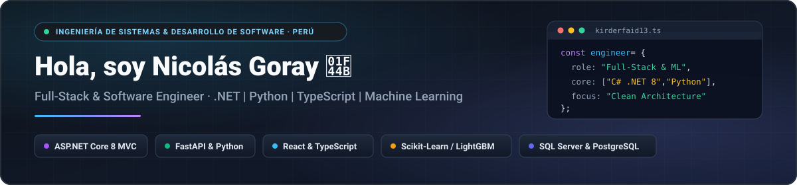
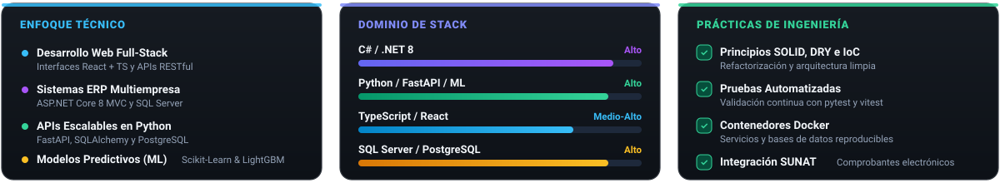

  

  
  
  
  

---

## 👨‍💻 Sobre mí

Soy **Nicolás Goray**, desarrollador de software y estudiante de **Ingeniería de Sistemas Computacionales (UPN)**. Me especializo en construir aplicaciones web confiables, plataformas empresariales con **C# / ASP.NET Core 8** y **SQL Server**, APIs escalables en **Python (FastAPI)** e interfaces modernas con **React + TypeScript**, integrando modelos de **Machine Learning** en flujos de trabajo reales.

- 🏗️ Experiencia desarrollando sistemas ERP multiempresa en **.NET 8** (ventas, caja, inventario, laboratorio y comprobantes electrónicos **SUNAT**).
- 🤖 Diseño de soluciones con **IA aplicada** (*Human-in-the-Loop*, clasificación de texto y modelos predictivos con **LightGBM / Scikit-Learn**).
- 🧱 Enfoque en arquitectura limpia, principios **SOLID / DRY / IoC**, pruebas automatizadas y despliegues reproducibles con **Docker**.

  

---

## 🚀 Proyectos Destacados

<table>
  <tr>
    <td width="50%" valign="top">
      <h3>🏥 PrediCitas CRP — Gestión Predictiva de Citas</h3>
      

        MVP de gestión predictiva de citas médicas posterior al agendamiento para apoyo operativo en clínica.
      

      <ul>
        <li><strong>Backend &amp; ML:</strong> API REST en <code>FastAPI</code>, <code>SQLAlchemy</code>, <code>PostgreSQL 16</code>, <code>Alembic</code> y modelos con <code>LightGBM</code> / <code>Scikit-Learn</code>.</li>
        <li><strong>Frontend:</strong> SPA en <code>React 18</code>, <code>TypeScript</code>, <code>Vite</code> y <code>Tailwind CSS</code>.</li>
        <li><strong>Calidad:</strong> Contenerizado con <code>Docker</code> y validado con <code>pytest</code> y <code>vitest</code>.</li>
      </ul>
      

        <a href="https://github.com/F1ld/backend-predicitas"><strong>🔗 Ver Backend API</strong></a> &nbsp;·&nbsp;
        <a href="https://github.com/F1ld/frontend-predicitas"><strong>🔗 Ver Frontend Web</strong></a>
      

    </td>
    <td width="50%" valign="top">
      <h3>🛡️ Detección de SMS Spam (Human-in-the-Loop ML)</h3>
      

        Aplicación web que analiza mensajes SMS, estima la probabilidad de spam y gestiona revisión humana en casos de baja confianza.
      

      <ul>
        <li><strong>Modelo ML:</strong> Pipeline supervisado de <code>TF-IDF + SVM Lineal Calibrada</code>.</li>
        <li><strong>Flujo Human-in-the-Loop:</strong> Automatiza predicciones seguras, deriva casos inciertos a revisión y exporta auditorías.</li>
        <li><strong>Stack:</strong> Interfaz en <code>Flask</code>, <code>Python</code>, <code>Jupyter</code> y persistencia en <code>SQLite</code>.</li>
      </ul>
      

        <a href="https://github.com/KirderFaid13/Sistema-de-Deteccion-de-Mensajes-SPAM"><strong>🔗 Ver Repositorio</strong></a>
      

    </td>
  </tr>
  <tr>
    <td width="50%" valign="top">
      <h3>👓 Gestiona Óptica — ERP Multiempresa (.NET 8)</h3>
      
<em>Sistema Empresarial (Repositorio Privado)</em>

      

        Plataforma ERP multiempresa orientada a ópticas en Perú, cubriendo todo el ciclo operativo y tributario.
      

      <ul>
        <li><strong>Módulos clave:</strong> Ventas, control de caja, inventario, órdenes de laboratorio óptico y facturación electrónica <strong>SUNAT</strong>.</li>
        <li><strong>Stack:</strong> <code>C#</code>, <code>ASP.NET Core 8 MVC</code>, <code>SQL Server (T-SQL)</code>, <code>HTML/CSS/JS</code>.</li>
      </ul>
    </td>
    <td width="50%" valign="top">
      <h3>⚙️ Modernización de Sistema Legado (RRHH)</h3>
      
<em>Arquitectura y Refactorización (Repositorio Privado)</em>

      

        Ingeniería inversa, refactorización y evolución controlada de un sistema legado de Recursos Humanos.
      

      <ul>
        <li><strong>Ingeniería:</strong> Aplicación progresiva de principios <code>SOLID</code>, <code>DRY</code> e Inversión de Control (<code>IoC</code>).</li>
        <li><strong>Calidad:</strong> Análisis funcional/arquitectónico, pruebas de validación y gestión formal de configuración y versiones en <code>C# / .NET</code>.</li>
      </ul>
    </td>
  </tr>
</table>

---

## 🛠️ Stack Tecnológico

### Lenguajes

### Backend, Frontend & Machine Learning

### Bases de Datos, Cloud & DevOps

---

## 📊 Estadísticas y Actividad en GitHub

  

  

---

  ¿Trabajamos juntos en un proyecto o quieres conversar sobre arquitectura de software, .NET, Python o ML? 
  Escríbeme a <a href="mailto:goraynicolas13@gmail.com"><strong>goraynicolas13@gmail.com</strong></a>

